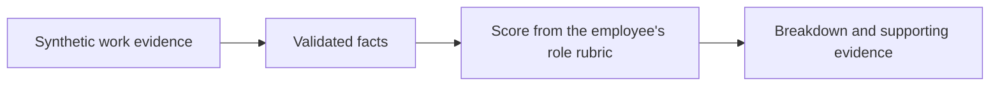

# Contriq

Contriq is an evidence-based performance scoring demo for 200 fictional, mid-level employees. It evaluates four job families over the same 90-day window and shows the work, rubric and calculations behind each result.

The project is at the documentation review stage. The planned stack is Next.js and TypeScript, a Cloudflare Workers-compatible API, and managed PostgreSQL.

| Document | What it covers |
| --- | --- |
| [AGENTS.md](AGENTS.md) | Instructions for future Codex sessions |
| [Project Context](docs/PROJECT_CONTEXT.md) | V1 scope, scoring principles and UX |
| [Decisions](docs/DECISIONS.md) | Agreed direction, proposals and open questions |
| [Handoff](docs/HANDOFF.md) | Workspace status and the next step |
| [System Architecture](docs/SYSTEM_ARCHITECTURE.md) | System boundaries and responsibilities |
| [Technical Architecture](docs/TECHNICAL_ARCHITECTURE.md) | Runtime, database access and test plan |
| [Flow](docs/FLOW.md) | Evidence ingestion, calculation, publication and reading |
| [API](docs/API.md) | Proposed read operations, response fields and states |
| [Schema Design](docs/SCHEMA_DESIGN.md) | ER diagram, table definitions and history protections |
