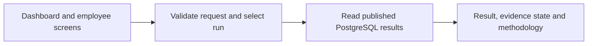

# API

Proposed V1 read contract. Route paths, versions, pagination and exact response shapes are open.

| Read | Input | Expected fields |
| --- | --- | --- |
| Overview | Evaluation window | Published run ID when available, cohort counts and coverage by family |
| Directory | Search, job family and optional team filters, evaluation window | Employee code, name, family, level, team and result state |
| Employee result | Employee code and evaluation window or published run ID | Total or insufficiency reason, six dimensions, optional submetric calculations, coverage, rubric version and evidence references |
| Methodology | Job family and optional rubric version | Dimensions, weights, approved formulas and eligibility rules for the selected rubric |

Return the window and run ID with published results so linked views can use the same calculation. Result detail references the exact rubric version and uses curated synthetic evidence fields. A lookup by exact rubric version can explain an earlier result after the active rubric changes.

| State | Suggested response |
| --- | --- |
| Published numeric result | `200` with the stored value and breakdown. Zero is a numeric value. |
| Published insufficient-evidence result | `200` with a null total, reason and available detail |
| Window has no published run | `200` with an explicit no-result state |
| Unknown employee or requested run/rubric version | `404` |
| Invalid search filter, identifier or evaluation bounds | `400` |
| Database temporarily unavailable | `503` with a generic error |

Scope the public contract to reads. Import and scoring operations use the trusted runner. Finalize response types and public reason codes alongside the [pending decisions](DECISIONS.md#pending-decisions).
