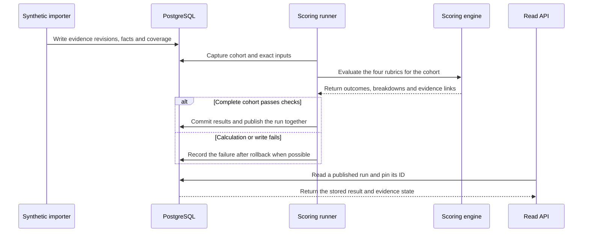

# Flow

V1 design draft

- Imports resolve employee codes and source identities before recording evidence. Invalid records with identifiable subjects can be kept with a reason. Repeat imports return the existing revision.
- The engine uses the job family from the captured cohort to choose the assigned rubric. A coverage gap is distinct from a complete source with zero activity.
- The UI starts with the result and period, then reveals dimension calculations, weights, coverage and evidence. It offers evidence-specific next steps, such as checking an unavailable source.
- The reader distinguishes a numeric zero, a published insufficient-evidence outcome, a window with no published run, and a service error. A failed run leaves the last published result available.

See [failure handling](SCHEMA_DESIGN.md#failure-handling) for database behavior.
