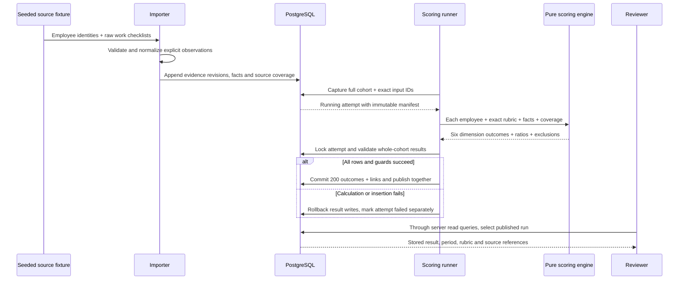

# Flow

## Source observations to a published result

1. `generateDataset(42)` generates 50 fictional employees per role, raw source checklists, intentional duplicates/invalid records and source coverage observations. It contains no final scores.
2. `normalizeEvidence()` extracts explicit binary metric facts. Deadline checks account for approved changes recorded before the original deadline. Invalid/ineligible observations retain reasons.
3. `seedDatabase()` and `ingestEvidence()` store one immutable revision at a time. Replays with equivalent content succeed without appending duplicates. Conflicting replays fail. Corrections identify the previous revision.
4. `captureRun()` resolves latest source revisions before subject filtering, then captures 200 employees, four active rubrics and exact input references. This prevents a correction or reattribution from leaving a superseded fact active.
5. `calculateRun()` checks the engine version and calls `scoreEmployee()` on each employee's pinned inputs. Coverage, eligibility, canonical duplicate resolution and complete dimension requirements determine whether a numeric total is available.
6. `publishRun()` recomputes and validates supplied results, then inserts scores, six dimension rows, metric rows and evidence links inside one transaction. It changes the attempt to published only when database guards approve the complete manifest.
7. `getOverview()`, `getEmployees()` and `getEmployee()` read the selected published run. Detail links keep the run ID so newly published data cannot silently alter that view.

## Reviewer flow

Overview → select a job family → search/filter people → open a person → inspect dimensions → expand metric arithmetic → inspect source records → read methodology. Query parameters preserve search, filters, pagination and run selection when moving back to the directory.

An insufficient-evidence result displays a null total, available dimensions and the missing source/metric reason. An observed false check contributes zero to its numerator while remaining in its denominator. An empty directory search shows an empty state. A PostgreSQL outage returns a service error and a retry affordance.
