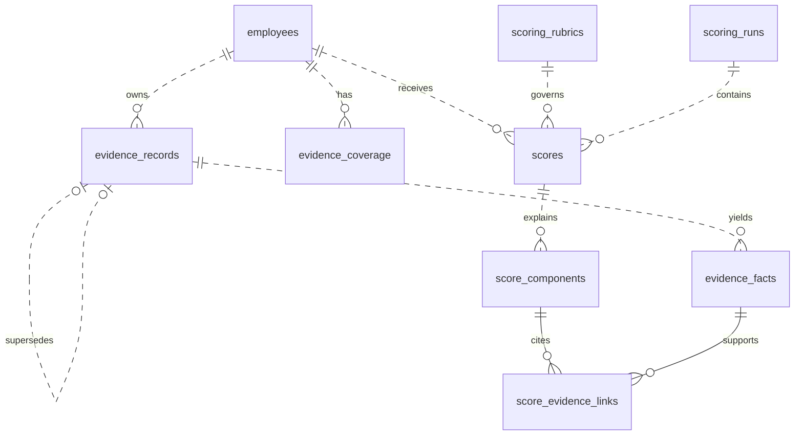

# PostgreSQL schema design

Proposed V1 design for the synthetic cohort. The nine tables follow the path from a source record to an explainable, published result.



Each dependent row belongs to one parent per required foreign key. An evidence revision has at most one predecessor and one successor. Components and facts have a many-to-many relationship through `score_evidence_links`. An employee has at most one result per run. Each published result has six dimension rows and may have submetric rows.

## Conventions

- Use UUID primary keys except for the generated bigint run ID and the composite link key. Required foreign keys restrict deletes. Unique constraints and primary keys supply their own indexes. Other indexes appear below.
- Use `date` for calendar boundaries and `timestamptz` for instants. Use UTC midnight at each boundary of a half-open 90-day window. Check dates and timestamps are finite and ordered where applicable.
- Use `numeric` for scores, weights and numeric operands. Reject non-finite numeric values. Keep scores and percentage weights within 0–100. Precision and rounding are [pending](DECISIONS.md#pending-decisions).
- Use checked text for closed sets such as statuses. The job family keys are `data_science`, `backend_engineering`, `full_stack_engineering` and `applied_agentic_ai`. The dimension keys are `delivery`, `quality`, `validation`, `reliability`, `maintainability` and `collaboration`.

## 1. employees

| Column | PostgreSQL type | Nullable | Purpose |
| --- | --- | --- | --- |
| id | uuid | No | Primary key |
| employee_code | text | No | Stable, unique synthetic directory code |
| name | text | No | Fictional display name |
| job_family | text | No | Current job family |
| job_level | text | No | Current level. The V1 cohort uses `mid`. |
| team | text | No | Fictional team |
| joined_at | date | No | Start date |

Require nonblank text. Index `(job_family, job_level, employee_code)` for directory filtering and ordering. Snapshot the evaluated role and level in the run so directory edits cannot change historical interpretation.

## 2. scoring_rubrics

| Column | PostgreSQL type | Nullable | Purpose |
| --- | --- | --- | --- |
| id | uuid | No | Primary key and permanent version reference |
| job_family | text | No | Family this rubric applies to |
| version | integer | No | Positive version number within that family |
| rules | jsonb | No | Dimensions, percentage weights, measurement definitions, expected evidence and role expectations |
| status | text | No | `draft`, `active` or `retired` |
| created_at | timestamptz | No | Version creation time |

Unique `(job_family, version)` and `(id, job_family)`. The second key supports the composite score foreign key. A partial unique index on `job_family` for active rows allows one active rubric per family. Validate the rules object before activation. Require all six known dimensions exactly once, weights that sum to 100, verified collaboration at 2%, and supported measurement definitions. The rules describe inputs and operators the engine knows how to evaluate. Changes to active rules require a new version. Activate the replacement and retire the earlier version in one transaction.

## 3. evidence_records

| Column | PostgreSQL type | Nullable | Purpose |
| --- | --- | --- | --- |
| id | uuid | No | Primary key for this revision |
| employee_id | uuid | No | Foreign key to `employees.id`, the subject attributed by this revision |
| source | text | No | Stable source namespace including the dataset or instance |
| source_record_id | text | No | Record identifier within the source |
| revision | integer | No | Positive, monotonic internal revision of this source record |
| supersedes_id | uuid | Yes | Self foreign key to the immediate prior revision |
| record_type | text | No | Source-specific record kind |
| observed_at | timestamptz | Yes | Event time. Required for valid records. |
| ingested_at | timestamptz | No | Time this revision was recorded |
| raw_payload | jsonb | No | Original source fields as received |
| normalizer_version | text | No | Version of validation and extraction logic |
| validation_status | text | No | `valid`, `invalid` or `retracted` |
| validation_reason | text | Yes | Reason for invalidity or retraction |

Unique `(source, source_record_id, revision)` makes exact replays idempotent. Require nonblank source keys and a reason for invalid or retracted rows. Revision 1 has no predecessor. Later revisions require one and `supersedes_id` is unique. In the ingest transaction, verify that the predecessor belongs to the same source key and has the immediately preceding revision. Index `(employee_id, observed_at)` for trace queries. Append a correction, revalidation or retraction and its facts in one transaction. A retry reuses its revision and returns the existing row if the source data agrees. A conflicting replay raises an error.

## 4. evidence_facts

| Column | PostgreSQL type | Nullable | Purpose |
| --- | --- | --- | --- |
| id | uuid | No | Primary key |
| evidence_id | uuid | No | Foreign key to the exact `evidence_records.id` revision |
| fact_type | text | No | Normalized measurement kind |
| fact_key | text | No | Stable measurement identifier within that record and fact type |
| canonical_fact_key | text | Yes | Shared measurement identity across duplicate sources or records |
| value_number | numeric | Yes | Numeric value |
| value_boolean | boolean | Yes | Boolean value |
| value_text | text | Yes | Text or category value |
| attributes | jsonb | No | Typed measurement metadata, such as a unit, as defined by its fact type |
| observed_at | timestamptz | No | Time of the measured event |
| validation_status | text | No | `valid` or `invalid` |
| validation_reason | text | Yes | Reason an extracted fact is invalid |

Unique `(evidence_id, fact_type, fact_key)` prevents duplicate extracts during ingest and indexes the foreign key. Require exactly one value column. Valid facts need a nonblank canonical key. Invalid facts need a reason. Verification also checks the parent record, units and fact-specific shape. Persist fact revisions through a new evidence revision so earlier results retain their original inputs.

## 5. evidence_coverage

| Column | PostgreSQL type | Nullable | Purpose |
| --- | --- | --- | --- |
| id | uuid | No | Primary key for a coverage observation |
| employee_id | uuid | No | Foreign key to `employees.id` |
| source | text | No | Source namespace used by evidence records |
| period_start | date | No | Inclusive start of the checked period |
| period_end | date | No | Exclusive end of the checked period |
| revision | integer | No | Positive, increasing observation revision within the coverage key |
| completeness_status | text | No | `complete`, `partial`, `unavailable` or `unknown` |
| last_checked_at | timestamptz | No | Time the source was checked |
| reason | text | Yes | Explanation for the observed coverage state |

Require `period_start < period_end`. Unique `(employee_id, source, period_start, period_end, revision)` supports replay and lookup. For V1, use the latest observation for the exact evaluation window. A missing observation means unknown coverage. A complete source may contain zero events. Append new observations and retain the exact revision each run used.

## 6. scoring_runs

| Column | PostgreSQL type | Nullable | Purpose |
| --- | --- | --- | --- |
| id | bigint generated always as identity | No | Primary key and selection order within a window |
| run_key | uuid | No | Unique caller-supplied attempt key for retry and commit reconciliation |
| started_at | timestamptz | No | Attempt start time |
| finished_at | timestamptz | Yes | Terminal transition time |
| status | text | No | `running`, `published` or `failed` |
| evaluation_start | date | No | Inclusive boundary |
| evaluation_end | date | No | Exclusive boundary, 90 days later |
| engine_version | text | No | Immutable reference to the engine build and its dependency versions |
| input_manifest | jsonb | No | Expected cohort and the exact inputs captured for each employee |
| failure_code | text | Yes | Internal failure reason for a failed attempt |

Require `finished_at` at or after `started_at` for published and failed runs. Require `failure_code` for failed runs. Otherwise the corresponding field is null. Index `(evaluation_start, evaluation_end, id DESC)` where the status is published. For each employee, the manifest pins their ID, job family and level, exact rubric ID, candidate evidence and fact IDs, and source coverage IDs or explicit gaps. Store IDs in a stable order and verify the manifest against the captured rows before scoring. Published and failed runs are terminal.

## 7. scores

| Column | PostgreSQL type | Nullable | Purpose |
| --- | --- | --- | --- |
| id | uuid | No | Primary key |
| employee_id | uuid | No | Foreign key to `employees.id` |
| run_id | bigint | No | Foreign key to `scoring_runs.id` |
| rubric_id | uuid | No | Exact rubric version used |
| job_family | text | No | Evaluated family from the run snapshot |
| total_score | numeric | Yes | Weighted result from 0 to 100 when calculated |
| status | text | No | `calculated` or `insufficient_evidence` |
| reason_code | text | Yes | Explanation code for insufficient evidence |
| calculated_at | timestamptz | No | Time the outcome was produced |

Unique `(run_id, employee_id)`. The composite foreign key `(rubric_id, job_family)` references `scoring_rubrics(id, job_family)`. Publication also matches the family and rubric to the employee's run snapshot. A calculated score has a numeric total and no insufficiency reason. An insufficient result has a null total and a reason. Index `(employee_id, run_id DESC)` for history and `(rubric_id, job_family)` for rubric references.

## 8. score_components

| Column | PostgreSQL type | Nullable | Purpose |
| --- | --- | --- | --- |
| id | uuid | No | Primary key |
| score_id | uuid | No | Foreign key to `scores.id` |
| dimension | text | No | One of the six dimension keys |
| submetric | text | Yes | Rubric submetric key. Null identifies the dimension row. |
| numerator | numeric | Yes | Numerator when the calculation uses a ratio |
| denominator | numeric | Yes | Denominator when the calculation uses a ratio |
| component_score | numeric | Yes | Calculated component value from 0 to 100 |
| weight_percent | numeric | Yes | Overall weight for a dimension or within-dimension weight if defined for a submetric |
| status | text | No | `calculated` or `unavailable` |
| reason_code | text | Yes | Explanation code when a component is unavailable |
| calculation_details | jsonb | No | Additional operands and intermediate steps needed to explain the calculation |

Use a partial unique index on `(score_id, dimension)` where `submetric IS NULL` and one on `(score_id, dimension, submetric)` where it is present. Index `score_id` for breakdown reads. A dimension row requires its weight. Ratio operands appear together, and a calculated ratio requires a nonzero denominator. Check that a calculated row has a value and that an unavailable row has a reason and no value. Publication verifies all six dimensions, their weights against the exact rubric and that each submetric belongs to its dimension.

## 9. score_evidence_links

| Column | PostgreSQL type | Nullable | Purpose |
| --- | --- | --- | --- |
| component_id | uuid | No | Foreign key to `score_components.id`, part of the primary key |
| fact_id | uuid | No | Foreign key to `evidence_facts.id`, part of the primary key |
| usage | text | No | `used` or `excluded` |
| exclusion_reason | text | Yes | Required for exclusions. Null for used facts. |

Primary key `(component_id, fact_id)` prevents repeated links. Index `fact_id` for reverse tracing. Verify that linked facts belong to the evaluated employee and the run snapshot. A used link requires a valid fact from a valid evidence revision in the evaluation window. Verify that each component uses a given `(fact_type, canonical_fact_key)` at most once. Raw records that could not produce a fact can still be traced through the run manifest.

## JSONB boundaries

| Field | Why JSONB |
| --- | --- |
| `scoring_rubrics.rules` | Versioned rule structure can evolve across job families and submetrics. Validate its full shape at activation. |
| `evidence_records.raw_payload` | Sources can supply different fields. JSONB preserves values while normalizing key order and formatting. Reject duplicate keys before storing source payloads. |
| `evidence_facts.attributes` and `score_components.calculation_details` | Different measurements need different metadata and operands. Keep identities, values, range constraints and relationships in columns. |
| `scoring_runs.input_manifest` | Pins the exact inputs and gaps in one immutable snapshot. Verify referenced IDs and their ownership during capture and publication. |

Require JSON objects for these fields. Use relational indexes for V1 reads. Add JSONB indexes if a measured query needs them. [PostgreSQL JSON types](https://www.postgresql.org/docs/current/datatype-json.html)

## From evidence to published results

1. **Ingest.** Resolve the employee and source identity. Validate the raw record, store its revision and extract typed facts in the same transaction. Append coverage observations independently. To find current evidence, resolve the newest revision for each logical source record before filtering on employee, time or validity. A retraction or change in attribution then displaces the previous revision.
2. **Capture.** Start a run with a stable attempt key. In a short repeatable-read transaction, capture the full 200-person fixture, current evidence and coverage, and one active rubric per family. Check the expected employee IDs, four family counts and level against the fixture. Save the manifest and a `running` row. Later evidence and rubric changes are available to later runs. A replay of this run uses its stored input IDs and engine version. [PostgreSQL transaction isolation](https://www.postgresql.org/docs/current/transaction-iso.html)
3. **Calculate.** Group facts by employee, fact type and canonical measurement identity. Use one representative of equivalent facts and retain the relevant exclusions. Withhold conflicting or unresolved measurements until they can be verified. The engine evaluates the approved rubric using those inputs and coverage, computes the weighted total where supported, and returns the components and exact evidence references.
4. **Publish.** In one transaction, lock the running attempt, write scores and their breakdowns, and check coverage of the captured cohort, rubric matches, component structure and evidence links. Require one outcome per captured employee, including explicit insufficiency when the approved rubric calls for it. Move the run to `published` only within that transaction. Enforce cross-row checks in the guarded write path. Row-level checks and foreign keys enforce the constraints they can express locally. [PostgreSQL constraints](https://www.postgresql.org/docs/current/ddl-constraints.html)
5. **Read.** Select the published run with the highest ID for the requested window and use that run ID across the dashboard, list and breakdown queries for the same view. Earlier complete runs remain addressable. A rollback or failed run cannot change which complete result is visible. An older attempt committing later cannot displace a higher published run ID.

The rubric's version, family and rules become read-only on activation. Evidence revisions, facts, coverage, captured inputs and published calculations are append-only. Restrict writes to the ingest and scoring workflows, expose published results through read-only queries, and give runtime roles no delete or truncate rights on history. Retain versioned engine builds and dependencies so stored inputs can be replayed. Verify the provider's backup and restore process before deploying.

## Failure handling

| Condition | Behavior and protection |
| --- | --- |
| Employee is missing | Reject the import with the unknown employee code. Foreign keys reject orphans. A run that cannot capture the expected cohort stays unpublished. |
| Evidence is repeated | Source revision and fact uniqueness prevent repeat ingest. Reject conflicting replays. Use canonical keys to group duplicates across source IDs, and withhold conflicting measurements pending resolution. |
| Data is invalid | Reject inputs without a resolvable identity. Preserve attributable, structurally valid JSON with an invalid status and reason when the content fails validation. Invalid inputs cannot contribute. |
| Sources are incomplete | Retain exact coverage observations and unknown gaps. Use the approved eligibility rules for any numeric outcome. Missing evidence stays distinct from zero. |
| Denominator is zero | Skip division and record why the component could not be computed. The consequence for eligibility remains a rubric decision. |
| Rubric belongs to another family | Reject the mismatch through the composite foreign key and the snapshot check. |
| Run stops midway | Roll back the publish transaction. Record failure in a separate transaction if the attempt is still running. Public reads continue to use the last published result. |
| Rubric changes | Activate a new version. Historical scores continue to reference the exact original rules. |
| Database connection drops | For an ambiguous write outcome, reconnect and check the stable attempt or revision key before retrying. Retry eligible transient failures with bounded retries. Treat unresolved read outages as service errors. |
| Source corrects or retracts evidence | Append a revision and recalculate in a new run where needed. Earlier runs retain the old raw record, facts, coverage and result. |
| History is accidentally edited or deleted | Restrict history writes, use foreign keys with restrictive deletes and keep backups. Corrections create new rows. |

## Example records

Fictional Backend Engineer `BE-004`, Rin Vale, is mid-level on Queue Systems and joined on `2025-06-02`. The source record below references the employee's example UUID.

```json
{
  "employee_id": "6da35027-d9c2-498d-8223-33b7f47109b7",
  "source": "synthetic/work-tracker",
  "source_record_id": "work-184",
  "revision": 1,
  "record_type": "work_item",
  "observed_at": "2026-08-12T10:30:00Z",
  "raw_payload": { "work_id": "work-184", "state": "accepted" },
  "validation_status": "valid"
}
```

An extracted fact could carry `fact_type = 'work_state'`, `value_text = 'accepted'` and the canonical key `'work-184:state'`. The example illustrates storage only. Its relevance, eligibility and score contribution depend on the approved Backend rubric.
