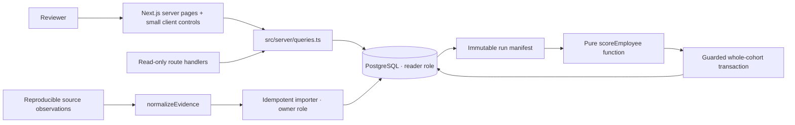

# System architecture

Contriq is one Next.js application with a local PostgreSQL database. The web process reads published fictional evaluations. Trusted command-line scripts import evidence and publish calculations.

| Boundary | Actual implementation | Responsibility |
| --- | --- | --- |
| Presentation | `app/` and `src/components/` | Overview, directory, detail, methodology, URL-based filters and accessible disclosures |
| Public HTTP interface | `app/api/` and `src/http.ts` | Validate query inputs, return JSON and safe errors |
| Read model | `src/server/queries.ts` | Resolve a published run and project stored evidence, results and rubrics |
| Database connections | `src/server/db.ts` | Reader/owner pools, bounded waits and transaction cleanup |
| Source processing | `src/domain/evidence.ts`, `src/server/ingest.ts` | Normalize checklists, preserve revisions and reject conflicting replay |
| Demonstration data | `src/domain/fixtures.ts` | Generate 200 fictional people and heterogeneous source records from seed 42 |
| Rubrics and engine | `src/domain/rubrics.ts`, `src/domain/engine.ts` | Role-specific definitions, exact ratio arithmetic and traceable outcomes |
| Trusted execution | `src/server/seed.ts`, `src/server/scoring.ts`, `scripts/` | Seed, capture, calculate, validate and atomically publish |
| Persistence | `db/migrations/` | Nine domain tables, migration bookkeeping and database integrity guards |

The browser receives curated fictional data and stored explanations. It has no database credentials or write controls. The backend calculates no scores during rendering. It reads one published run, keeping its ID in directory/detail links so a later publication cannot mix results within that exploration.

The owner scripts can write evidence and results. The web role has SELECT privileges. PostgreSQL foreign keys, checks, immutable-history triggers and publication guards complement the TypeScript checks. The numerical rubric remains a provisional synthetic demonstration.
