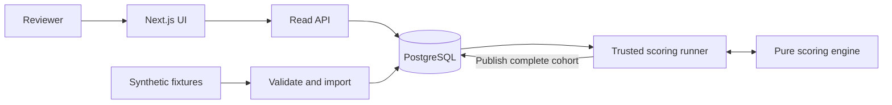

# System architecture

V1 design draft

| Boundary | Responsibility |
| --- | --- |
| UI | Overview, directory, score detail and methodology. Explain the stored result. |
| Read API | Validate requests and project the published run, breakdown and approved evidence fields. |
| Importer | Resolve employees, deduplicate input revisions, verify facts and record coverage. |
| Scoring runner | Select the cohort and rubric versions, capture inputs, call the engine and publish atomically. |
| Scoring engine | Compute outcomes and calculation details from typed inputs and a role rubric. |
| PostgreSQL | Store the inputs, history and published results. Enforce relational integrity. |

Keep these boundaries in one application codebase with one database. Cloudflare Workers is the preferred web deployment. The trusted runner can start as a local entry point. The deployment layout is pending.

The public demo serves fictional data through read operations. Data import and scoring publication use a trusted execution path with separate database permissions. Publishers require exactly one outcome for every employee in the run before the new cohort becomes visible. See [Schema Design](SCHEMA_DESIGN.md#from-evidence-to-published-results).
