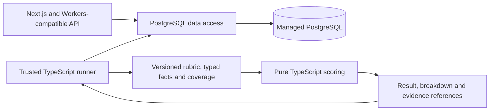

# Technical architecture

V1 design draft

| Area | Design |
| --- | --- |
| Web runtime | Next.js and TypeScript. Verify the chosen adapter and required features in a local Workers runtime. Cloudflare's vinext option implements the Next.js API and is in beta. Its fit is open. [Cloudflare Next.js guide](https://developers.cloudflare.com/workers/framework-guides/web-apps/nextjs/) |
| Database access | Use parameterized queries and a compatible driver. Hyperdrive is a candidate for Workers connection pooling. Keep each transaction on a single checked-out connection. The provider and driver are pending. [Hyperdrive pooling](https://developers.cloudflare.com/hyperdrive/concepts/connection-pooling/) |
| Read consistency | Resolve a published run once per view and pin its ID. If using Hyperdrive, start with query caching off for current-run selection and transactions that capture inputs. [Hyperdrive query caching](https://developers.cloudflare.com/hyperdrive/concepts/query-caching/) |
| Scoring | Pass versioned inputs, use a stable order and follow a documented decimal policy. Keep clocks, randomness, queries and network calls outside the engine. |
| Local verification | Use PostgreSQL for integration tests. Exercise replays, revision conflicts, invalid inputs, wrong-family rubrics, missing coverage and a rolled-back publication. Test the engine with approved fixtures once the formulas are settled. |

## Risks to resolve

| Risk | Check |
| --- | --- |
| The framework or driver depends on a runtime feature Workers lacks. | Run a local route, read and transaction smoke test in the target runtime before picking the stack variants. |
| Evidence volume makes a full-cohort publication too slow. | Measure execution time and write size with the synthetic fixture. Keep the transaction short by calculating before opening it. |
| Evidence IDs differ for the same work or contradict each other. | Define source mappings and test deduplication and exclusion before scoring. |
| Suggested weights are mistaken for a complete rubric. | Keep the weights proposed and activate only after the actual measures, thresholds and missing-data rules are approved. |
| A public demo exposes writes or non-synthetic records. | Keep write operations outside the public API and verify fixtures and response fields as part of release review. |
