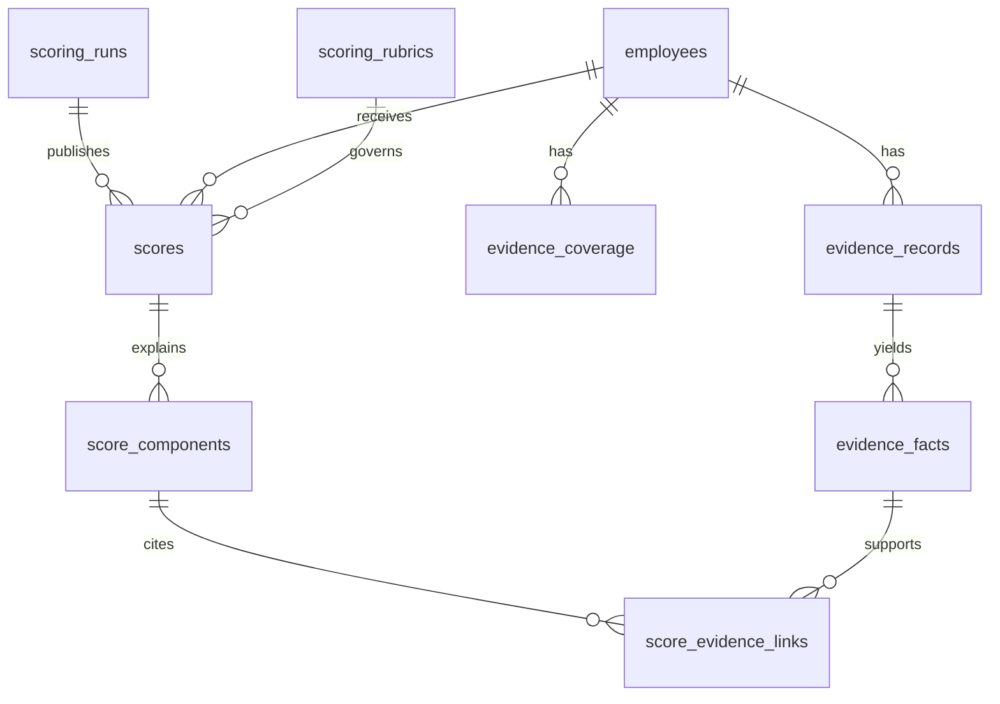

# Database explained

PostgreSQL stores separate records for people, source observations, normalized facts and results. The separation lets you inspect a calculation and preserve earlier results after evidence changes.

## Relationships

## The nine domain tables

| Table | Important keys and example | Reader/writer and failure behavior |
| --- | --- | --- |
| `employees` | UUID `id` is the primary key. `employee_code` such as CQ-004 is unique. Role, level, team and joined date describe the person. | Seed writes it. Scoring captures identity into the manifest. Duplicate codes and unsupported roles are rejected. |
| `scoring_rubrics` | UUID `id`, family and positive version identify the rule set. `rules` is JSONB. Only one active rubric per family. | Seed/`activateRubric()` writes it. Engine and methodology read it. Activated rules cannot be overwritten. |
| `evidence_records` | UUID `id`, employee FK, source key and revision identify the original observation. `supersedes_id` points to the previous source revision. | `ingestEvidence()` appends it. Detail reads captured revisions. Wrong employee/predecessor references and conflicting replays fail. |
| `evidence_facts` | UUID `id`, `evidence_id` FK, metric type/key, canonical work identity and typed value describe the normalized check. Attributes include its denominator. | Importer writes it. Engine reads captured IDs. Checks require one typed value and a reason for invalidity. |
| `evidence_coverage` | UUID `id`, employee FK, source, exact window and observation revision record complete/partial/unavailable/unknown availability. | `ingestCoverage()` appends it. Scoring selects latest exact-window observations. Missing observations become explicit gaps. |
| `scoring_runs` | Bigint `id`, unique `run_key`, engine version and JSONB input manifest pin a whole cohort. Status starts running and becomes published or failed. | `captureRun()` creates it. `publishRun()` performs its guarded terminal transition. A failed attempt cannot displace a published one. |
| `scores` | UUID `id`, employee/run FKs and composite rubric/family FK identify one outcome. Total is numeric or null with an insufficiency reason. | Publisher writes it. Queries read it. One result per employee per run and the correct rubric family are enforced. |
| `score_components` | UUID `id` and score FK hold six dimension rows plus metric rows. A null `submetric` identifies a dimension. Operands, weight and details explain it. | Publisher writes it. Detail reads it. Duplicate rows or unavailable components without reasons are rejected. |
| `score_evidence_links` | Composite primary key `(component_id,fact_id)` connects a metric to exact facts. Usage is used/excluded with reasons. | Publisher writes it. Detail reads provenance. Duplicate links and invalid ownership/snapshot references are rejected. |

`schema_migrations` is a tenth table for migration bookkeeping rather than a domain entity. It records the SQL filename, checksum and applied timestamp.

## Learn the SQL terms through Contriq

A **primary key** uniquely identifies a row. Isha's internal UUID is stable even if a later directory name changes. A **foreign key** requires a referenced row to exist. A score cannot point to an invented employee. A **one-to-many relationship** lets one employee own many evidence records. A **many-to-many relationship** lets several components refer to several facts through the link table.

**JSONB** stores flexible structured fields inside PostgreSQL. `raw_payload` preserves source values and `rules` preserves metric definitions. Important joins and range checks still use typed columns. PostgreSQL may reorder JSONB keys, so import replay comparison normalizes JSON structure instead of depending on serialization order.

An **index** accelerates a known access path. The employee-history index finds results for one employee, while the partial published-run index finds the latest complete result for a window. Extra indexes cost writes and storage, so V1 uses the specific documented ones.

A **migration** is an ordered change to the database structure. [migrate.ts](../src/server/migrate.ts) checks each applied file's checksum before continuing. A later change belongs in a new file. A **constraint** rejects an invalid row. **Triggers** add revision, immutability and publication checks that compare related rows.

A **transaction** groups changes into one unit. [transaction()](../src/server/db.ts) checks out one connection, begins the unit, runs the operation, then commits or rolls back. If insertion of the final employee fails, its new cohort stays unpublished. Existing history remains visible.

## Verify the relationships

Ask Codex to inspect CQ-004's score ID and follow its `score_components`, `score_evidence_links`, `evidence_facts` and `evidence_records`. The SQL table definitions are in [001_core.sql](../db/migrations/001_core.sql), with stricter guards in migrations 002 and 003. [Database tests](../tests/database.test.ts) deliberately try wrong-family references, duplicate replays, history edits and incomplete publication inside rollback-only transactions.
