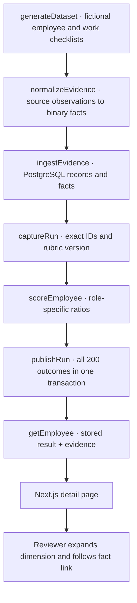

# How the app works

Use `CQ-004`, Isha Mehta, as a concrete example. She is one of the fictional Data Scientists. Her source records exist because the deterministic fixture generator created attributed work observations, not because a final score was typed into a seed file.

## Before opening the browser

`npm run setup` calls the [local setup script](../scripts/setup-local.sh). It starts PostgreSQL, applies migrations, runs the seed and invokes scoring. [seedDatabase()](../src/server/seed.ts) obtains the employee and source fixture, persists identities and rubric definitions, and calls the importer. The importer uses [normalizeEvidence()](../src/domain/evidence.ts) to create typed numerator observations.

A source checklist can say that a specific Data Science analysis met its agreed objective and whether it was reproduced in handoff. The raw JSONB payload preserves the observations. Extracted facts have permanent IDs and canonical work identities. A mirrored source record can exist, while the engine counts its equivalent measurement once.

## The calculation

[captureRun()](../src/server/scoring.ts) creates a manifest containing Isha's identity, Data Science rubric ID, evidence/fact IDs and source coverage revisions. [calculateRun()](../src/server/scoring.ts) loads exactly those inputs and calls the shared [scoreEmployee()](../src/domain/engine.ts).

The engine selects the metric definitions already attached to the Data Science rubric. It uses complete sources and valid current measurements, counts passing checks and eligible observations, then calculates ratios and weighted dimensions. It records which facts counted and why others were excluded. Isha's exact total is 43.875, displayed as 43.88. See [the complete worked example](SCORING_ENGINE_EXPLAINED.md).

[publishRun()](../src/server/scoring.ts) writes all 200 outcomes and their details atomically. A late failed insert rolls back the new run's result writes. The previously published dataset stays readable.

## The browser request

Opening `/employees/CQ-004` invokes [the employee page](../app/employees/[code]/page.tsx). It calls [getEmployee()](../src/server/queries.ts) on the server. That function chooses the published run, reads its stored components, reads the exact rubric referenced by the score and joins source facts into the response.

The page receives typed data and renders identity, coverage, score, six dimensions and evidence. It does not rerun scoring during display. Clicking a fact uses [FactLink](../src/components/fact-link.tsx) to open the source disclosure and scroll to the matching fact. Raw JSON is rendered as escaped text.

To verify this path, compare `/api/employees/CQ-004` with the screen. Its `runId`, rubric version, numerator/denominator pairs and total should agree. The HTTP end-to-end test automates that comparison at the response level. The browser checks cover the actual disclosure interaction.
