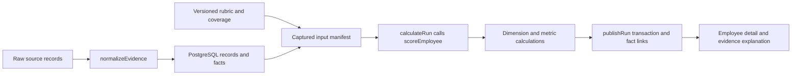

# Understand and defend the scoring engine

Contriq turns fictional, work-linked observations into traceable checklist ratios. It uses one TypeScript engine with four configurations. It does not ask an LLM to judge a person. The result describes the supplied work observations under a provisional rubric; the mathematics being repeatable does not make the rubric scientifically validated.

Read this alongside the precise [scoring contract](../docs/SCORING_CONTRACT.md), then open [`src/domain/engine.ts`](../src/domain/engine.ts). The key exported function is `scoreEmployee`. It takes an employee, their exact rubric, normalized facts, coverage and an optional period. It returns the score, six components, eleven metric calculations, used/excluded evidence IDs, availability reasons and engine version. It has no database, network or React dependency.

## The four files to understand first

| File and function | What it does | Why it exists | How to verify |
| --- | --- | --- | --- |
| [`src/domain/rubrics.ts`](../src/domain/rubrics.ts): `getRubrics`, `getRubric` | Defines four version-1 rubrics, eleven checks per family, sources and weights. | Role expectations differ, while arithmetic can be shared. | Read the metric labels and exact weight arrays; run the rubric test. |
| [`src/domain/evidence.ts`](../src/domain/evidence.ts): `normalizeEvidence` | Checks raw record shapes and converts boolean observations into typed facts; derives deadline checks when dates are supplied. | Database/application code should not invent a second interpretation of raw evidence. | Open a raw record and its facts; inspect normalizer tests. |
| [`src/domain/engine.ts`](../src/domain/engine.ts): `validateRubric`, `scoreEmployee` | Validates scoring configuration, selects eligible inputs, deduplicates, computes exact ratios and returns trace details. | One deterministic formula must serve the UI, stored results and tests. | Run `npx tsx --test tests/scoring.test.ts`. |
| [`src/domain/fixtures.ts`](../src/domain/fixtures.ts): `generateDataset` | Makes 200 fictional employees and raw records from a repeatable seed, then normalizes them. | The demo needs evidence from which to calculate, rather than baked-in final scores. | Call twice with seed 42; tests compare the full returned structures. |

Engine build is `binary-checklist-1.0.1`. Rubric version stays 1 because the role definitions and weights remain the initial demonstration configuration. Rubric version and engine version describe different things: configuration versus calculation implementation.

## Why four rubrics and six dimensions?

The same six dimensions organize all four roles: delivery, technical quality, validation, reliability, maintainability and verified collaboration. That makes the explanation consistent. Their checks and emphasis differ: a Data Scientist has leakage checks, a Backend Engineer has contract tests, a Full Stack Engineer has responsive/error-state checks, and an Agentic AI Engineer has adversarial/unsafe-action checks.

The weights come from the brief. For Data Science they are 24, 25, 27, 12, 10 and 2 percent. Backend uses 28, 27, 20, 14, 9 and 2; Full Stack uses 30, 25, 18, 15, 10 and 2; Agentic AI uses 24, 24, 29, 12, 9 and 2. Each set totals 100. These differences are product assumptions for the synthetic V1, not proven estimates of what makes someone effective.

There are two checks inside each of the first five dimensions, weighted 50% each. Collaboration has one check, weighted 100% inside its small 2% dimension. The [complete 44-row metric definitions](../docs/SCORING_CONTRACT.md#complete-metric-definitions) give every role's eleven checks. For each row, a pass means exactly the stated property was observed in a source checklist.

Collaboration carries only 2% because the product deliberately minimizes subjective inputs. Its check is a verified review that unblocked another work item. No popularity score, personality judgment, Slack activity or online time enters the calculation.

## Follow a raw observation into a number

Use the actual default-seed employee **CQ-004, Isha Mehta**, a mid-level Data Scientist on Measurement Lab. Her employee UUID is `0000000a-0000-4000-8000-000000000004`. The period includes UTC midnight on 23 August 2026 and stops before UTC midnight on 21 November 2026.

Her first delivery record has these actual fields, abbreviated to the fields that explain the calculation:

```json
{
  "id": "00000002-0000-4000-8000-00000000004e",
  "employeeId": "0000000a-0000-4000-8000-000000000004",
  "source": "demo:delivery",
  "sourceRecordId": "CQ-004:78",
  "revision": 1,
  "observedAt": "2026-10-15T12:00:00Z",
  "rawPayload": {
    "title": "Demand forecast calibration",
    "workId": "CQ-004:work:1",
    "eligible": true,
    "checks": {
      "data_science.delivery.1": false,
      "data_science.delivery.2": false
    }
  }
}
```

`normalizeEvidence` requires an explicit eligibility flag and boolean checks. The first check says the analysis did not satisfy acceptance against its agreed objective; the second says the result did not satisfy the reproduced-handoff check. Each is an **observed false**, so it contributes zero passing units out of one observed eligible unit. It is not treated as missing data.

The first normalized fact is:

```json
{
  "id": "00000003-0000-4000-8000-0000000004e0",
  "evidenceId": "00000002-0000-4000-8000-00000000004e",
  "metricKey": "data_science.delivery.1",
  "canonicalKey": "CQ-004:work:1",
  "numerator": 0,
  "denominator": 1,
  "validationStatus": "valid"
}
```

The companion fact ending `4e1` is the second delivery check. It is also 0/1. The fact's `evidenceId` links back to the exact raw revision. When the engine includes it in an available metric, its UUID appears in `usedFactIds`; the backend persists that relationship in `score_evidence_links`.

For Isha, the four delivery observations are:

| Work | Title | Raw evidence UUID suffix | Acceptance check | Reproduced-handoff check |
| --- | --- | --- | --- | --- |
| 1 | Demand forecast calibration | `004e` | false | false |
| 2 | Retention cohort analysis | `004f` | false | true |
| 3 | Inventory anomaly study | `0050` | false | false |
| 4 | Experiment allocation audit | `0051` | true | true |

The first metric is `1 / 4 × 100 = 25`. The second is `2 / 4 × 100 = 50`. Each weighs half of delivery, so delivery is `25 × 0.5 + 50 × 0.5 = 37.5`. Data Science delivery weighs 24% overall, so its contribution is `37.5 × 0.24 = 9` points.

## Complete calculation: Isha scores 43.88

This table was obtained by executing the real fixture and engine, not by inventing a convenient result:

| Dimension | Passing units for its checks | Scores of its checks | Dimension score | Overall weight | Exact contribution |
| --- | --- | --- | ---: | ---: | ---: |
| Delivery | 1/4, 2/4 | 25, 50 | 37.50 | 24% | 9 |
| Quality | 1/4, 2/4 | 25, 50 | 37.50 | 25% | 9.375 |
| Validation | 2/4, 2/4 | 50, 50 | 50.00 | 27% | 13.5 |
| Reliability | 1/4, 3/4 | 25, 75 | 50.00 | 12% | 6 |
| Maintainability | 1/4, 3/4 | 25, 75 | 50.00 | 10% | 5 |
| Collaboration | 2/4 | 50 | 50.00 | 2% | 1 |

The exact sum is `43.875`; half-up rounding to two decimals gives **43.88**. Her coverage is **100%**, because all six required sources are complete. Low observed checklist results do not reduce evidence coverage.

The general calculation is:

```text
metric      = passing eligible observed units / eligible observed units × 100
dimension   = sum(metric × metric weight / 100)
contribution= dimension × dimension weight / 100
overall     = sum(unrounded contributions)
```

The code uses exact integer fractions with `BigInt`, so a ratio such as 2/3 is kept as a fraction during weighting. It rounds the displayed metric, dimension, contribution and overall independently, half up to two decimal places. It never feeds rounded display values back into the overall calculation. The helper `display` performs that rounding; `ROUNDING_POLICY` in `rubrics.ts` states the policy. Stored JSON numbers may appear as `50`; the UI formats them as `50.00` where appropriate.

To reproduce Isha's result from the repository root:

```bash
npx tsx -e 'import {generateDataset} from "./src/domain/fixtures"; import {getRubric} from "./src/domain/rubrics"; import {scoreEmployee} from "./src/domain/engine"; const data=generateDataset(); const employee=data.employees.find(e=>e.code==="CQ-004")!; console.log(JSON.stringify(scoreEmployee({employee,rubric:getRubric(employee.jobFamily),facts:data.facts,coverage:data.coverage}),null,2));'
```

Ask Codex: “Run the CQ-004 scoring walkthrough and explain one metric's raw record, fact IDs, numerator, denominator and weight.”

## Deadline changes have an explicit rule

The source's raw times determine reliability when deadline fields are supplied. An approved scope change can move a deadline only when its agreement was recorded **before the old deadline**. A change agreed at or after the old deadline cannot retroactively make late work timely. Delivery exactly at the effective deadline passes. If there was no scope change, the scope-record check passes.

Isha's raw tracker record `00000002-0000-4000-8000-00000000005b` (`CQ-004:91`) is an actual late-change example:

```text
Original deadline:       2026-10-14 18:00 UTC
Change agreement:       2026-10-16 12:00 UTC
Requested new deadline: 2026-10-17 18:00 UTC
Delivery:               2026-10-18 12:00 UTC
```

The agreement came after the original deadline. `normalizeEvidence` therefore retains the original deadline, sets on-time delivery false, and sets timely scope-record false. The normalized checks do not merely trust the raw checklist when these date fields exist. Invalid dates reject the record's scoring facts. For generic tracker records without deadline fields, explicit boolean observations remain valid inputs.

The regression test `deadline revisions require approval before the original deadline` also checks a timely approved extension and the no-change case.

## Missing evidence is different from poor observed outcomes

Each source has a separate coverage observation for the exact employee and evaluation period. The newest coverage revision wins. A missing observation means unknown. A partial, unavailable or unknown source makes its metrics unavailable. Conflicting coverage observations at the latest revision are also withheld. The engine never says “no connector data, therefore zero performance.”

Even a complete source can have no eligible events. Its denominator is then zero, so the result is unavailable rather than `0/0`, infinity or an invented zero score. A known eligible source work item with one metric missing also makes that metric unavailable.

Every required metric must be available for its dimension, and every dimension must be available for an overall result. Otherwise the total is `null` and status is `insufficient_evidence`. Other valid dimension scores remain visible; their weights do not expand to fill the gap.

Coverage is a separate number:

```text
100 × number of distinct required sources with complete coverage
    / number of distinct required sources
```

Five complete sources out of six means **83.33%**, regardless of the missing dimension's weight. Six complete sources can still yield no overall score because measurements conflict or a denominator is zero. Coverage describes source availability, not whether every measurement is usable.

During integration, the first engine implementation reported coverage as the sum of calculable dimensions' weights. The backend counted complete sources. This caused different coverage numbers for the same evidence and mixed coverage with performance eligibility. The fix was to use the source fraction above. The named regression `source coverage is independent of rubric weights and observed outcomes` changes rubric weights while preserving 83.33%, then demonstrates 100% coverage with a zero-denominator unavailable score.

## What duplicates, invalid inputs and revisions do

`scoreEmployee` first selects the latest revision of each source record, before deciding which employee or period it belongs to. That matters if a correction changes the owner: the old employee must not keep credit. A retracted or invalid correction does not revive the older observation.

For a metric, the identity is its metric key plus the canonical work ID. Two mirror records saying the same thing count once. If one says true and the other false for that same measurement, the metric is withheld; the engine does not choose whichever outcome is convenient. Unrelated metric keys are ignored. Invalid, ineligible, wrong-source and out-of-period facts receive exclusion reasons rather than contributing to the ratio.

The same work item may legitimately have an acceptance check and a test-quality check: those measure different properties. Two copies of its acceptance check may not produce two denominator units. The fixture includes both ordinary mirrors and deliberate conflicts so this behavior is inspectable.

Fact IDs must also remain stable. Raw JSON property order is sorted before extraction. Synthetic fact IDs preserve a readable sequence; arbitrary source UUIDs use a deterministic identity hash of the whole source revision UUID and metric key. This fixed an integration bug where multiplying a large UUID suffix made a malformed fact UUID. The test `arbitrary UUID source revisions normalize to valid stable fact UUIDs without suffix overflow` uses a maximum suffix and verifies both valid UUID shape and property-order replay stability. The hash is not used for security.

## Where the database participates

The pure engine does not fetch or save anything. [`src/server/ingest.ts`](../src/server/ingest.ts), through `ingestEvidence`, calls the normalizer and appends raw records and facts to PostgreSQL. The database also checks relationships, source revision chains and conflicting replay. These ingestion protections are separate from score arithmetic.

[`src/server/scoring.ts`](../src/server/scoring.ts) captures an input manifest with exact employee/rubric/evidence/fact/coverage IDs. `calculateRun` reads the pinned inputs and calls `scoreEmployee`. `publishRun` recomputes the captured inputs and writes all 200 results in one transaction. Its evidence links reference the exact fact revisions returned by the engine. This is how an explanation can be replayed rather than relying on today's edited employee record or today's active rubric.



## How to defend the result and its limits

If asked “Why is her score low?”, point to ratios: Isha passed one of four acceptance checks and one of four statistical-assumptions checks. Those are grounded statements about the supplied evidence. The application cannot infer attitude, effort or personality from them.

If asked “How can you prove it is correct?”, distinguish arithmetic from policy. The **19 executed tests** in [`tests/scoring.test.ts`](../tests/scoring.test.ts) verify the arithmetic and failure modes, including a hand-calculated 86-point backend example, exact fractional rounding, duplicate/revision handling and deterministic cohort replay. The policies remain provisional. Run `npx tsx --test tests/scoring.test.ts` to verify them yourself.

If asked “What does the fixture contain?”, the default seed creates exactly 200 employees, 50 per family, 4,900 raw records, 8,960 facts and 1,212 coverage observations including historical revisions. Twelve employees, three per family, have insufficient evidence. The fixture stores observations, not final scores; the engine calculates results each run.

If asked “What is the biggest limitation?”, explain that equal binary work units simplify the demo. A tiny sample, a difficult task and an easy task are not distinguished by complexity. Completeness is a declared source assertion; the system cannot discover work missing from every source. No real source integration verifies the synthetic acceptance/review assertions. The application demonstrates provenance, missing-data handling and reproducible arithmetic, not a validated basis for real employment decisions.

Continue with [How the app works](HOW_THE_APP_WORKS.md) or return to [Start here](START_HERE.md).
